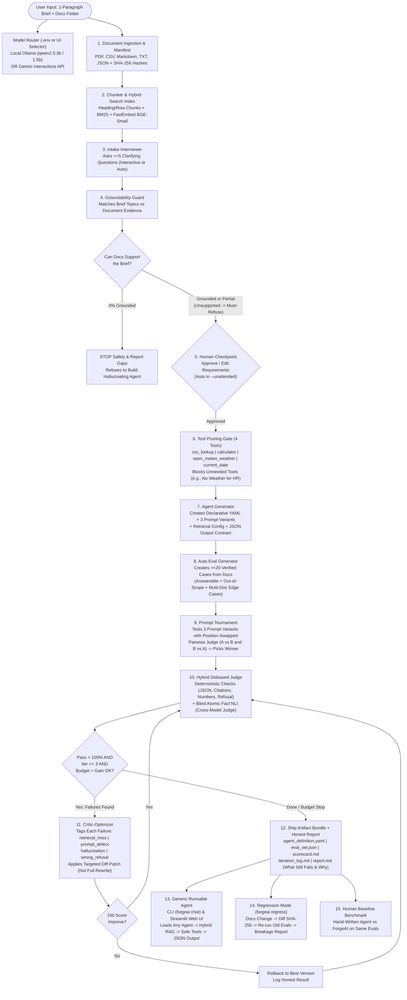

# ForgeAI Architecture Blueprint

ForgeAI is an autonomous **Agent Factory** designed to operate reliably even when every reasoning step runs on a small, imperfect open model (e.g., `qwen2.5:1.5b` / `qwen2.5:3b` via local Ollama) while seamlessly supporting **Google Gemini (Interactions API)** from `.env` or UI selection.

## 1. End-to-End Architecture Flowchart (Simple View)

## 2. Why This Architecture Survives Small Open Models

Small local models (`1.5B–3B`) fail in predictable ways: broken JSON, overly eager tool invocation, hallucinating missing policy numbers, losing facts across chunks, and judge biases. ForgeAI compensates through **structural orchestration**, never hoping the model is smarter than it is:

1. **JSON Repair & Schema Coercion (`llm/base.py`)**: Every structured call validates against Pydantic v2, retries with explicit schema error feedback, extracts fenced/substring JSON blocks, and applies deterministic defaults on non-critical fields.
2. **Evidence-First Groundability Guard (`factory/groundability.py`)**: Before any agent is generated, the factory extracts atomic capabilities/claims from the brief and queries the actual document index (BM25 + Dense vector similarity + CSV column schema inspection). Any claim with zero supporting evidence is marked `UNSUPPORTED` and automatically added to `must_refuse_topics` with an explicit gap warning—preventing the factory from generating prompts that invite fabrication.
3. **Deterministic + LLM Tool Pruning (`tools/registry.py`, `factory/generator.py`)**:
   - Seven sandboxed tools exist: `csv_lookup`, `json_record_lookup`, `calculator`, `unit_converter`, `currency_converter`, `open_meteo_weather`, and `current_date`.
   - Deterministic capability gates block impossible tools first (e.g., `csv_lookup` cannot attach if zero `.csv` files exist; `json_record_lookup` requires `.json` files; `open_meteo_weather`, `currency_converter`, and `unit_converter` require explicit domain intent).
   - The LLM selector only chooses from eligible tools and must justify each with a brief quote; post-checks strip any unjustified attachment.
4. **Hybrid Retrieval with Score Gating (`retrieval/hybrid.py`)**:
   - Heading/paragraph-aware chunking for PDFs/Markdown/TXT plus structured row-summary + schema chunking for CSVs.
   - Reciprocal Rank Fusion (RRF) combining `BM25Okapi` (exact SKU/policy-code precision) and `FastEmbed` `BAAI/bge-small-en-v1.5` (semantic recall on CPU ONNX, saving GPU VRAM for Ollama).
   - Minimum score cutoff triggers deterministic abstention signals when retrieval returns low-relevance noise.
5. **Hybrid Debiased Judge (`factory/judge.py`)**:
   - **Deterministic Gate Checks**: Output contract schema validity, cited source document existence, excerpt token overlap against retrieved chunks, numeric/unit/SKU exactness check, refusal classification vs `expected_behavior`, and verbosity fluff ratio.
   - **Atomic Fact NLI (No Holistic Vibe Scoring)**: Instead of asking a small model "rate 1-5", each expected `key_fact` is checked individually (`SUPPORTED` / `MISSING` / `CONTRADICTED`), and any unsupported extra factual claim in the answer is penalized.
   - **Anti-Bias Defenses**:
     - *Self-Preference Defense*: Judge prompts never expose the agent's system prompt or author identity, and support a dedicated cross-model (`judge_model != generator_model`, e.g., `qwen2.5:1.5b` judging `qwen2.5:3b` or Gemini Flash Lite judging Flash).
     - *Position Bias Defense*: Prompt Tournament pairwise comparisons evaluate `(Candidate A, Candidate B)` in **both** forward and swapped orders `(A, B)` and `(B, A)`; inconsistent ties default to deterministic metrics.
     - *Verbosity Bias Defense*: Long padded answers incur a verbosity penalty when token ratio exceeds expected fact density or introduces unverified statements.
6. **Targeted Critic–Optimizer Loop (`factory/optimizer.py`)**:
   - Every failed eval case is tagged with one of 4 failure classes: `retrieval_miss`, `prompt_defect`, `hallucination`, `wrong_refusal`.
   - Instead of regenerating the entire agent from scratch, the optimizer applies a **minimal surgical patch** targeting the dominant failure cluster (e.g., adjusting `top_k` / `chunk_size` / `hybrid_alpha` for `retrieval_miss`; appending/tightening a specific citation or refusal clause for `prompt_defect` / `hallucination`; refining boundary clauses or `min_score_threshold` for `wrong_refusal`).
   - **Rollback Guard & Budget Early Stop**: Every iteration compares score delta against `--min-gain-threshold` and enforces token + latency ceilings. If a patch drops overall quality or exceeds budget, ForgeAI rolls back to the best checkpoint and records the failed experiment honestly.
7. **Honest Reporting (`factory/reporter.py`)**:
   - Outputs per-iteration scorecards, failure taxonomy distributions, Prompt Tournament comparison, budget consumption, and a dedicated **"What Still Fails & Why"** section enumerating failing test IDs, root causes, and model/document limitations.

## 3. Supported Model Backends

| Mode | Configuration | Use Case |
| :--- | :--- | :--- |
| **Local Ollama** | `OLLAMA_HOST=http://127.0.0.1:11434`, `qwen2.5:3b` / `qwen2.5:1.5b` | Offline, zero API cost, small open model evaluation |
| **Gemini API (Interactions API)** | `GEMINI_API_KEY=...` in `.env`, `client.interactions.create(...)` | Fast cloud validation & cross-model judging via `google-genai` |
| **Auto / Hybrid** | Select provider independently for Factory/Agent vs Judge in CLI or Streamlit UI | Eliminates judge self-preference bias |

## 4. Artifact Bundle Layout

Every factory run writes a self-contained runnable bundle:
- `requirements.yaml` & `requirements.md`: Scope, audience, tone, clarifying Q&A, groundability gaps, must-answer & must-refuse topics.
- `agent_definition.yaml` & `agent_definition.json`: Declarative system prompt, retrieval config, selected tools, output contract, model metadata.
- `eval_set.json`: Auto-generated >=20 test cases (answerable, out-of-scope, multi-doc edge cases) with source docs & key facts.
- `tournament_results.json`: Candidate prompt variants and debiased comparison scores.
- `iteration_log.json` & `iteration_log.md`: Per-iteration targeted diffs, failure IDs targeted, before/after scores, rollbacks.
- `scorecard.json` & `scorecard.md`: Metric breakdown across iterations and question categories.
- `report.md`: Executive summary, honest failure audit ("what still fails and why"), budget usage.
- `corpus_manifest.json`: SHA-256 document hashes enabling `forgeai regress` change detection.
